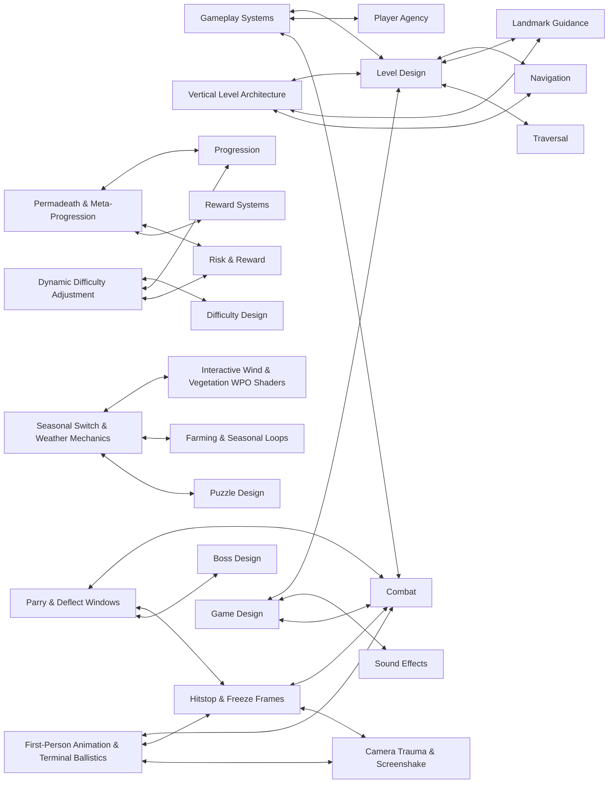

# 🔗 Linked Systems — Oyun Mekanikleri Bağlantı Ağı

Bu sayfa, kütüphanedeki tüm oyun mekaniklerinin birbirini nasıl beslediğini ve **Obsidian Graph View / Quartz 4** üzerinde nasıl düğüm oluşturduğunu özetler.

## Mimari Bağlantı Diyagramı (Core Mechanics Network)

## Ana Sistem Düğümleri ve WikiLinks Bağlantıları

- **[[Gameplay_Systems|Gameplay Systems]]** (`Level Design`) -> [[Level_Design|Level Design]], [[Player_Agency|Player Agency]], [[Combat]], [[Enemy_Design|Enemy Design]]
- **[[Vertical_Level_Architecture|Vertical Level Architecture]]** (`Level Design`) -> [[Level_Design|Level Design]], [[Landmark_Guidance|Landmark Guidance]], [[Navigation]], [[Traversal]], [[Volumetric_Lighting_Darkness|Volumetric Lighting & Darkness]], [[Mental_Mapping|Mental Mapping]]
- **[[First_Person_Animation_Terminal_Ballistics|First-Person Animation & Terminal Ballistics]]** (`Combat`) -> [[Combat]], [[Hitstop_Freeze_Frames|Hitstop & Freeze Frames]], [[Camera_Trauma_Screenshake|Camera Trauma & Screenshake]], [[Parry_Deflect_Windows|Parry & Deflect Windows]], [[Rollback_Netcode_Prediction|Rollback Netcode & Prediction]]
- **[[Permadeath_Meta_Progression|Permadeath & Meta-Progression]]** (`Progression`) -> [[Progression]], [[Risk_Reward|Risk & Reward]], [[Reward_Systems|Reward Systems]], [[Difficulty_Design|Difficulty Design]], [[Procedural_World_Generation|Procedural World Generation]]
- **[[Seasonal_Switch_Weather_Mechanics|Seasonal Switch & Weather Mechanics]]** (`World Building`) -> [[Interactive_Wind_Vegetation_WPO_Shaders|Interactive Wind & Vegetation WPO Shaders]], [[Farming_Seasonal_Loops|Farming & Seasonal Loops]], [[Puzzle_Design|Puzzle Design]], [[World_Building|World Building]], [[Exploration]]
- **[[Parry_Deflect_Windows|Parry & Deflect Windows]]** (`Combat`) -> [[Combat]], [[Hitstop_Freeze_Frames|Hitstop & Freeze Frames]], [[Boss_Design|Boss Design]], [[Enemy_AI|Enemy AI]], [[Camera_Trauma_Screenshake|Camera Trauma & Screenshake]], [[Rollback_Netcode_Prediction|Rollback Netcode & Prediction]]
- **[[Hitstop_Freeze_Frames|Hitstop & Freeze Frames]]** (`Combat`) -> [[Combat]], [[Camera_Trauma_Screenshake|Camera Trauma & Screenshake]], [[Parry_Deflect_Windows|Parry & Deflect Windows]], [[Adaptive_Audio_Stems|Adaptive Audio & Stems]], [[First_Person_Animation_Terminal_Ballistics|First-Person Animation & Terminal Ballistics]]
- **[[Dynamic_Difficulty_Adjustment|Dynamic Difficulty Adjustment]]** (`Difficulty Design`) -> [[Difficulty_Design|Difficulty Design]], [[Progression]], [[Risk_Reward|Risk & Reward]], [[Enemy_AI|Enemy AI]], [[Reward_Systems|Reward Systems]]
- **[[Game_Design|Game Design]]** (`Level Design`) -> [[Level_Design|Level Design]], [[Sound_Effects|Sound Effects]], [[Combat]], [[Exploration]], [[Resource_Management|Resource Management]], [[Game_Maker_S_Toolkit_In_2019|Game Maker S Toolkit In 2019]]
- **[[Level_Design|Level Design]]** (`Level Design`) -> [[Navigation]], [[Landmark_Guidance|Landmark Guidance]], [[Traversal]], [[Vertical_Level_Architecture|Vertical Level Architecture]], [[Coyote_Time_Input_Buffering|Coyote Time & Input Buffering]], [[Procedural_World_Generation|Procedural World Generation]]
- **[[Farming_Seasonal_Loops|Farming & Seasonal Loops]]** (`Economy`) -> [[Economy]], [[Crafting]], [[Progression]], [[Reward_Systems|Reward Systems]], [[World_Building|World Building]], [[Virtual_Home_Belonging_Hubs|Virtual Home & Belonging Hubs]]
- **[[Point_And_Click_Puzzle_Design|Point And Click Puzzle Design]]** (`Level Design`) -> [[Level_Design|Level Design]], [[Player_Agency|Player Agency]], [[Combat]]
- **[[Automated_Drone_Farming_Batch_Crafting|Automated Drone Farming & Batch Crafting]]** (`Crafting`) -> [[Farming_Seasonal_Loops|Farming & Seasonal Loops]], [[Virtual_Home_Belonging_Hubs|Virtual Home & Belonging Hubs]], [[Economy]], [[Crafting]], [[Progression]]
- **[[Progression]]** (`Progression`) -> [[Reward_Systems|Reward Systems]], [[Permadeath_Meta_Progression|Permadeath & Meta-Progression]], [[Economy]], [[Difficulty_Design|Difficulty Design]], [[Dynamic_Difficulty_Adjustment|Dynamic Difficulty Adjustment]], [[Farming_Seasonal_Loops|Farming & Seasonal Loops]]
- **[[Combat]]** (`Combat`) -> [[Parry_Deflect_Windows|Parry & Deflect Windows]], [[Hitstop_Freeze_Frames|Hitstop & Freeze Frames]], [[Enemy_AI|Enemy AI]], [[Boss_Design|Boss Design]], [[Camera_Trauma_Screenshake|Camera Trauma & Screenshake]], [[Coyote_Time_Input_Buffering|Coyote Time & Input Buffering]]
- **[[Puzzle_Solving|Puzzle Solving]]** (`Level Design`) -> [[Level_Design|Level Design]], [[Player_Agency|Player Agency]], [[Combat]], [[Speedrunning]]
- **[[Gameplay_Mechanics|Gameplay Mechanics]]** (`Level Design`) -> [[Level_Design|Level Design]], [[Player_Agency|Player Agency]], [[Combat]], [[Character_Design|Character Design]], [[Sound_Design|Sound Design]], [[Game_Loop|Game Loop]]
- **[[Core_Systems|Core Systems]]** (`Level Design`) -> [[Level_Design|Level Design]], [[Progression]], [[Player_Experience|Player Experience]], [[Player_Progression|Player Progression]], [[The_Many_Dimensions_Of_Kirby|The Many Dimensions Of Kirby]], [[The_Making_Of_Divinity_Original_Sin_2|The Making Of Divinity Original Sin 2]]

---

> [!TIP] **Bu kütüphaneyi çevrimdışı kullanmak ve kendi oyununuza uyarlamak ister misiniz?**
> Tam Obsidian Vault veritabanını, Unreal Engine 5 / Unity 6 / Godot 4 hazır parametre tablolarını, GDD şablonlarını, ChatGPT/Claude/NotebookLM sürükle-bırak paketlerini, API anahtarsız MCP Sunucusunu ve kendi anahtarınızla çalışan Yerel AI Sorgu Aracını (CLI) içeren **Supporter Pack**'i [Itch.io Supporter Pack](https://emirkankirman2353.itch.io/game-mechanics-systems-vault-ue5-unity-6-godot-4-aimcp) üzerinden indirerek bu 7/24 büyüyen yaşayan kütüphaneye destek olabilirsiniz!
