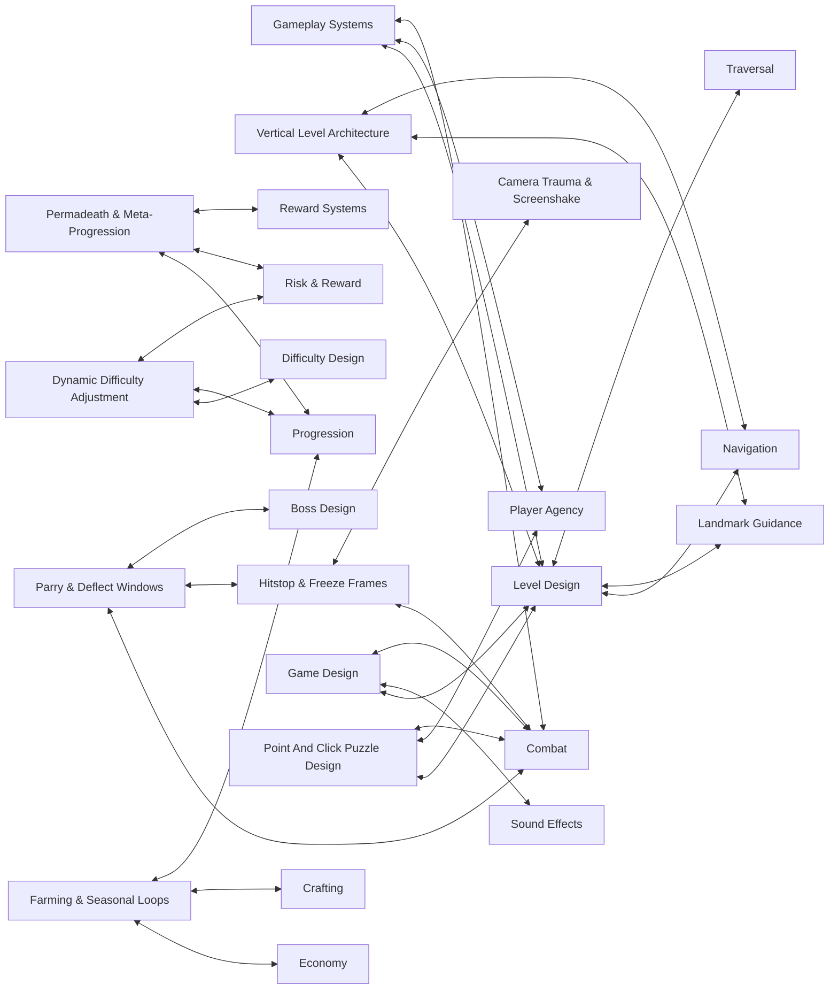

# 🔗 Linked Systems — Oyun Mekanikleri Bağlantı Ağı

Bu sayfa, kütüphanedeki tüm oyun mekaniklerinin birbirini nasıl beslediğini ve **Obsidian Graph View / Quartz 4** üzerinde nasıl düğüm oluşturduğunu özetler.

## Mimari Bağlantı Diyagramı (Core Mechanics Network)

## Ana Sistem Düğümleri ve WikiLinks Bağlantıları

- **[[Gameplay Systems]]** (`Level Design`) -> [[Level Design]], [[Player Agency]], [[Combat]], [[Enemy Design]]
- **[[Vertical Level Architecture]]** (`Level Design`) -> [[Level Design]], [[Landmark Guidance]], [[Navigation]], [[Traversal]], [[Volumetric Lighting & Darkness]], [[Mental Mapping]]
- **[[Permadeath & Meta-Progression]]** (`Progression`) -> [[Progression]], [[Risk & Reward]], [[Reward Systems]], [[Difficulty Design]], [[Procedural World Generation]]
- **[[Parry & Deflect Windows]]** (`Combat`) -> [[Combat]], [[Hitstop & Freeze Frames]], [[Boss Design]], [[Enemy AI]], [[Camera Trauma & Screenshake]], [[Rollback Netcode & Prediction]]
- **[[Hitstop & Freeze Frames]]** (`Combat`) -> [[Combat]], [[Camera Trauma & Screenshake]], [[Parry & Deflect Windows]], [[Adaptive Audio & Stems]]
- **[[Dynamic Difficulty Adjustment]]** (`Difficulty Design`) -> [[Difficulty Design]], [[Progression]], [[Risk & Reward]], [[Enemy AI]], [[Reward Systems]]
- **[[Game Design]]** (`Level Design`) -> [[Level Design]], [[Sound Effects]], [[Combat]], [[Exploration]], [[Resource Management]], [[Game Maker S Toolkit In 2019]]
- **[[Level Design]]** (`Level Design`) -> [[Navigation]], [[Landmark Guidance]], [[Traversal]], [[Vertical Level Architecture]], [[Coyote Time & Input Buffering]], [[Procedural World Generation]]
- **[[Point And Click Puzzle Design]]** (`Level Design`) -> [[Level Design]], [[Player Agency]], [[Combat]]
- **[[Farming & Seasonal Loops]]** (`Economy`) -> [[Economy]], [[Crafting]], [[Progression]], [[Reward Systems]], [[World Building]]
- **[[Progression]]** (`Progression`) -> [[Reward Systems]], [[Permadeath & Meta-Progression]], [[Economy]], [[Difficulty Design]], [[Dynamic Difficulty Adjustment]], [[Farming & Seasonal Loops]]
- **[[Combat]]** (`Combat`) -> [[Parry & Deflect Windows]], [[Hitstop & Freeze Frames]], [[Enemy AI]], [[Boss Design]], [[Camera Trauma & Screenshake]], [[Coyote Time & Input Buffering]]
- **[[Puzzle Solving]]** (`Level Design`) -> [[Level Design]], [[Player Agency]], [[Combat]], [[Speedrunning]]
- **[[Gameplay Mechanics]]** (`Level Design`) -> [[Level Design]], [[Player Agency]], [[Combat]], [[Character Design]], [[Sound Design]], [[Game Loop]]
- **[[Core Systems]]** (`Level Design`) -> [[Level Design]], [[Progression]], [[Player Experience]], [[Player Progression]], [[The Many Dimensions Of Kirby]], [[The Making Of Divinity Original Sin 2]]
- **[[Game Development]]** (`Level Design`) -> [[Level Design]], [[Player Agency]], [[Combat]], [[The State And Future Of Board Games]]
- **[[Shader Rim & Silhouette]]** (`Visual Art & Shaders`) -> [[Volumetric Lighting & Darkness]], [[Combat]], [[Camera & Player Perspective]], [[Diegetic Guidance]]
- **[[Anti-Pattern Playbook]]** (`Retention & Live Systems`) -> [[Retention & Live Systems]], [[Player Guidance]], [[Economy]], [[Difficulty Design]], [[Combat]]

---

> [!TIP] **Bu kütüphaneyi çevrimdışı kullanmak ve kendi oyununuza uyarlamak ister misiniz?**
> Tam Obsidian Vault veritabanını, Unreal Engine 5 / Unity 6 / Godot 4 hazır parametre tablolarını, GDD şablonlarını, ChatGPT/Claude/NotebookLM sürükle-bırak paketlerini, API anahtarsız MCP Sunucusunu ve kendi anahtarınızla çalışan Yerel AI Sorgu Aracını (CLI) içeren **Supporter Pack**'i [Itch.io Supporter Pack](https://emirkankirman2353.itch.io/game-mechanics-systems-vault-ue5-unity-6-godot-4-aimcp) üzerinden indirerek bu 7/24 büyüyen yaşayan kütüphaneye destek olabilirsiniz!
